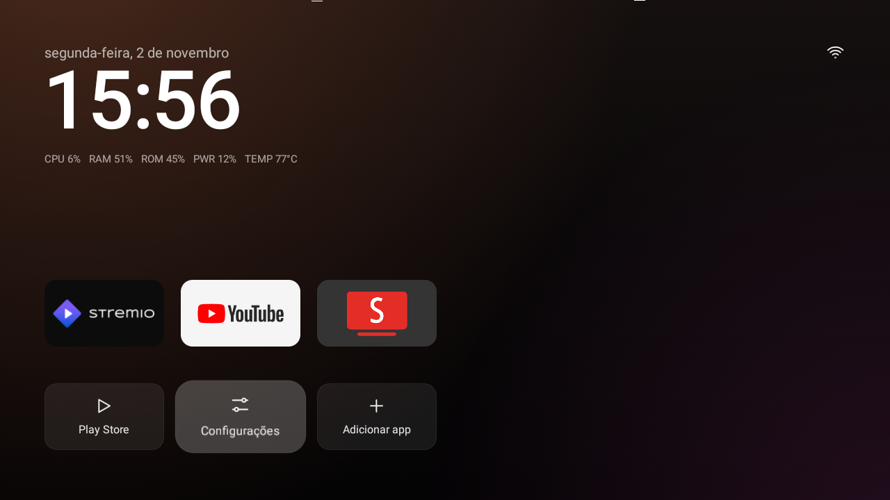

# Allwinner H3 TV box: cleanup and optimization

**English** · [Português](README.pt-BR.md)

ADB-based cleanup and optimization of a generic Allwinner H3 TV box (`dolphin_fvd_p1`).



> Validated on a single device. Some steps require root and modify `/system`. Back up first.

## Device

| Item | Specification |
|---|---|
| SoC | Allwinner H3, 4× Cortex-A7 at 1.008 GHz |
| RAM | 1 GB (the system reports 8 GB) |
| Storage | 8 GB NAND |
| OS | Android 7.0 (SDK 24), `eng` build, kernel 4.4.55 |

## Results

| Metric | Before | After |
|---|---|---|
| `/data` usage | 83% | 36% |
| YouTube launch | 1,306 ms | 1,020 ms |
| Settings launch | 1,537 ms | 1,431 ms |
| NAND sequential read | 24.7 MB/s | 26.6 MB/s |

Averages of 3 runs per configuration. Details in [docs/desempenho.md](docs/desempenho.md).

## Steps

1. Back up the partitions.
2. Disable and remove unwanted apps.
3. Replace the launcher with [TV Detox](https://github.com/Ansub/tv-detox), plus a [custom patch](patches/tv-detox-tvbox-h3.patch).
4. Clear the Kodi cache and turn off location.
5. Tune NAND I/O, applied at every boot.

Commands in [docs/procedimento.md](docs/procedimento.md).

## Launcher

The patch adds to TV Detox:

- support for devices without a TV input service;
- a system usage line below the clock: `CPU`, `RAM`, `ROM`, `PWR` and `TEMP`;
- an option under **Settings** to show or hide that line.

`RAM` uses the real memory, not the total reported by the system. `PWR` is the share of CPU capacity in use (active
cores × frequency), since the box has no power sensor.

To build the APK:

```sh
scripts/build-launcher.sh
```

Requires Git, Java 17+ and the Android SDK with platform and build-tools 34 or 35. The APK is written to
`build/tvhome.apk`. To update an installed launcher, sign it with the same key:
`KEYSTORE=path/key.jks scripts/build-launcher.sh`.

## Layout

| Path | Contents |
|---|---|
| `config/` | `io-tuning.rc`, I/O tuning read by `init` |
| `scripts/` | launcher build, temporary tuning and A/B test |
| `listas/` | disabled and removed packages |
| `patches/` | TV Detox patch |
| `build/` | build output, not tracked by Git |
| `resultados/` | raw A/B test data |
| `docs/` | documentation |

## Documentation

The detailed documentation is in Portuguese.

- [Procedure](docs/procedimento.md)
- [Performance](docs/desempenho.md)
- [Security](docs/seguranca.md)
- [Recovery](docs/restauracao.md)
- [Linux on NAND](docs/linux-nand.md)

## Limitations

- The main bottleneck is thermal: above 85 °C the box shuts down cores. This needs a physical fix.
- Restoring the backup has not been tested.
- The firmware ships with built-in root and a 2016 security patch. Do not treat the box as trustworthy.

## References

- [CleanYourTV](https://github.com/Gathin23/cleanyourtv)
- [TV Detox](https://github.com/Ansub/tv-detox)
- [TVBox-Allwinner-H3-with-Linux](https://github.com/Gabrick75/TVBox-Allwinner-H3-with-Linux)
- [linux-sunxi: H3](https://linux-sunxi.org/H3)
- [Android init](https://android.googlesource.com/platform/system/core/+/master/init/README.md)
- [Linux: queue sysfs](https://www.kernel.org/doc/html/latest/block/queue-sysfs.html)

## License

[MIT](LICENSE). The patch is derived from TV Detox (MIT, © 2026 Ansub Khan).
