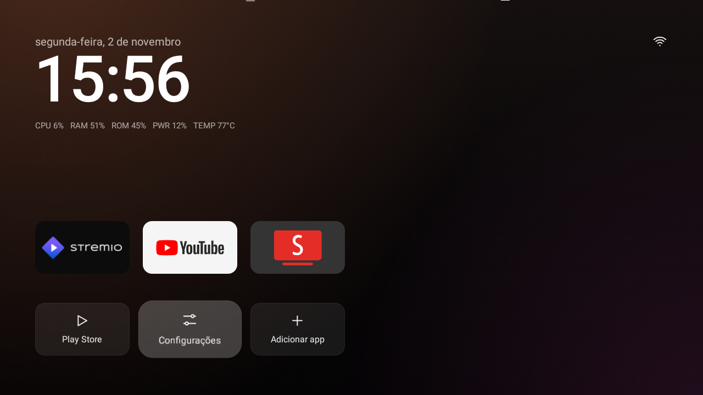

# TV box Allwinner H3: limpeza e otimização

[English](README.md) · **Português**

Limpeza e otimização via ADB de uma TV box genérica com Allwinner H3 (`dolphin_fvd_p1`).



> Procedimento validado em um único aparelho. Alguns passos exigem root e alteram o `/system`. Faça backup antes.

## Aparelho

| Item | Especificação |
|---|---|
| SoC | Allwinner H3, 4× Cortex-A7 a 1,008 GHz |
| RAM | 1 GB (o sistema anuncia 8 GB) |
| Armazenamento | 8 GB NAND |
| Sistema | Android 7.0 (SDK 24), build `eng`, kernel 4.4.55 |

## Resultados

| Métrica | Antes | Depois |
|---|---|---|
| Uso do `/data` | 83% | 36% |
| Abertura do YouTube | 1.306 ms | 1.020 ms |
| Abertura das Configurações | 1.537 ms | 1.431 ms |
| Leitura sequencial da NAND | 24,7 MB/s | 26,6 MB/s |

Médias de 3 rodadas por configuração. Detalhes em [docs/desempenho.md](docs/desempenho.md).

## Etapas

1. Backup das partições.
2. Desativação e remoção de apps indesejados.
3. Troca do launcher pelo [TV Detox](https://github.com/Ansub/tv-detox), com [patch](patches/tv-detox-tvbox-h3.patch) próprio.
4. Limpeza do cache do Kodi e desativação da localização.
5. Ajuste de I/O da NAND, aplicado a cada boot.

Comandos em [docs/procedimento.md](docs/procedimento.md).

## Launcher

O patch adiciona ao TV Detox:

- compatibilidade com aparelhos sem serviço de entradas de TV;
- linha de uso do sistema abaixo do relógio: `CPU`, `RAM`, `ROM`, `PWR` e `TEMP`;
- opção em **Configurações** para mostrar ou ocultar essa linha.

`RAM` usa a memória real, não o total anunciado pelo sistema. `PWR` é a fração da capacidade da CPU em uso (núcleos
ativos × frequência), já que a box não tem sensor de energia.

Para gerar o APK:

```sh
scripts/build-launcher.sh
```

Requer Git, Java 17+ e Android SDK com plataforma e build-tools 34 ou 35. O APK é gerado em `build/tvhome.apk`.
Para atualizar um launcher já instalado, assine com a mesma chave: `KEYSTORE=caminho/key.jks scripts/build-launcher.sh`.

## Estrutura

| Caminho | Conteúdo |
|---|---|
| `config/` | `io-tuning.rc`, ajuste de I/O lido pelo `init` |
| `scripts/` | build do launcher, aplicação temporária do ajuste e teste A/B |
| `listas/` | pacotes desativados e removidos |
| `patches/` | patch do TV Detox |
| `build/` | saída do build, fora do Git |
| `resultados/` | dados brutos do teste A/B |
| `docs/` | documentação |

## Documentação

- [Procedimento](docs/procedimento.md)
- [Desempenho](docs/desempenho.md)
- [Segurança](docs/seguranca.md)
- [Restauração](docs/restauracao.md)
- [Linux na NAND](docs/linux-nand.md)

## Limitações

- O gargalo principal é térmico: acima de 85 °C a box desliga núcleos. Isso exige solução física.
- A restauração do backup não foi testada.
- O firmware tem root embutido e patch de segurança de 2016. A box não deve ser considerada confiável.

## Referências

- [CleanYourTV](https://github.com/Gathin23/cleanyourtv)
- [TV Detox](https://github.com/Ansub/tv-detox)
- [TVBox-Allwinner-H3-with-Linux](https://github.com/Gabrick75/TVBox-Allwinner-H3-with-Linux)
- [linux-sunxi: H3](https://linux-sunxi.org/H3)
- [Android init](https://android.googlesource.com/platform/system/core/+/master/init/README.md)
- [Linux: queue sysfs](https://www.kernel.org/doc/html/latest/block/queue-sysfs.html)

## Licença

[MIT](LICENSE). O patch deriva do TV Detox (MIT, © 2026 Ansub Khan).
